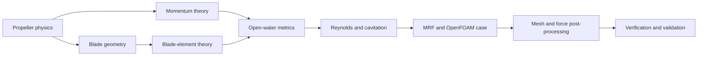

# Marine propeller CFD: learning guide

This chapter set builds from marine propulsion physics to the OpenFOAM case and
its post-processing. It assumes familiarity with undergraduate fluid mechanics
and finite-volume CFD, but introduces marine-specific language and metrics.

> [!IMPORTANT]
> The current propeller STL is a **geometry-development proxy**, not a
> geometrically faithful Wageningen B5-75 blade. Its blade surface is built from
> sparse radial/chordwise points; it does not yet resolve the full pressure and
> suction-side sections, section camber, hub-blade junction, rake, or skew.
> The current mesh and solver run are workflow tests only. Their forces must
> not be reported as propeller performance or validation.

## Learning path

1. [Propeller physics and force directions](01_propeller_physics.md)
2. [Actuator-disk momentum theory](02_actuator_disk.md)
3. [Propeller geometry and B-series notation](03_blade_geometry.md)
4. [Blade-element theory](04_blade_element_theory.md)
5. [Open-water coefficients and efficiency](05_open_water_performance.md)
6. [Governing equations and turbulence closure](06_governing_equations.md)
7. [Reynolds similarity and cavitation](07_reynolds_similarity_cavitation.md)
8. [MRF: rotating-frame physics](08_mrf_physics.md)
9. [OpenFOAM case files](09_openfoam_case_walkthrough.md)
10. [Mesh and wall-resolution decisions](10_mesh_and_wall_resolution.md)
11. [Forces, metrics, and post-processing](11_forces_and_postprocessing.md)
12. [Convergence, verification, and validation](12_convergence_verification_validation.md)
13. [Worked operating-point example](13_operating_point_worked_example.md)
14. [Common errors and diagnostic reasoning](14_common_failure_modes.md)
15. [Wake, loading, and ship propulsion](16_wake_hull_interaction_and_loading.md)
16. [Self-assessment and worked checks](17_self_assessment.md)

The [references and further reading](15_references.md) section is supplementary
and lists the technical sources used throughout the chapters.

## Notation and units

| Symbol | Meaning | SI unit |
|---|---|---|
| $D$ | Propeller diameter | m |
| $R=D/2$ | Propeller radius | m |
| $Z$ | Number of blades | dimensionless |
| $n$ | Rotational rate | s$^{-1}$ (rev/s) |
| $\Omega=2\pi n$ | Angular speed | rad/s |
| $V_A$ | Undisturbed advance speed | m/s |
| $\rho$ | Fluid density | kg/m$^3$ |
| $\nu$ | Kinematic viscosity | m$^2$/s |
| $T$ | Axial thrust magnitude | N |
| $Q$ | Shaft torque magnitude | N m |
| $J$ | Advance coefficient | dimensionless |
| $K_T,K_Q$ | Thrust and torque coefficients | dimensionless |

Use $n$ in revolutions per second in coefficient equations. Convert rotational
speed from rpm using $n=\mathrm{rpm}/60$. Use $\Omega=2\pi n$ only where angular
speed in radians per second is required.

## Repository case map

| Learning topic | Case implementation |
|---|---|
| Operating-point velocity | [`0/U`](../04_MRF_Steady/baseline/0/U) |
| Water properties | [`transportProperties`](../04_MRF_Steady/baseline/constant/transportProperties) |
| Turbulence model | [`turbulenceProperties`](../04_MRF_Steady/baseline/constant/turbulenceProperties) |
| Rotating frame | [`MRFProperties`](../04_MRF_Steady/baseline/constant/MRFProperties) |
| Discretization | [`fvSchemes`](../04_MRF_Steady/baseline/system/fvSchemes) |
| Linear solvers/SIMPLE | [`fvSolution`](../04_MRF_Steady/baseline/system/fvSolution) |
| Runtime and force output | [`controlDict`](../04_MRF_Steady/baseline/system/controlDict) |
| Domain mesh | [`blockMeshDict`](../04_MRF_Steady/baseline/system/blockMeshDict) |
| Surface mesh | [`snappyHexMeshDict`](../04_MRF_Steady/baseline/system/snappyHexMeshDict) |
| Current test status | [`test_status.md`](../docs/test_status.md) |

## What this guide does not claim

- The B-series regression curve is not raw test data.
- The generated STL is not exact or measured B5-75 geometry.
- A solver run is not a validated result merely because it completes.
- MRF does not resolve blade-passage transients.
- A steady, single-phase case cannot predict cavitation.

Proceed to [propeller physics](01_propeller_physics.md).
